<picture>
  <source media="(prefers-color-scheme: dark)" srcset="./assets/river-dark.svg">
  <source media="(prefers-color-scheme: light)" srcset="./assets/river-light.svg">
  
</picture>

**Tech Lead at Property Group, Warsaw.** I build web and mobile products end to end — React front-ends in a TypeScript monorepo, the Node services behind them, and the Kubernetes clusters they run on. I care about what happens after the deploy: monitoring, SLAs and calm incident response.

**AI in the loop** — I build our engineering workflow around AI agents: Claude Code with custom skills for specs, code review, estimation and bug analysis, so the team spends its time on decisions, not boilerplate.
